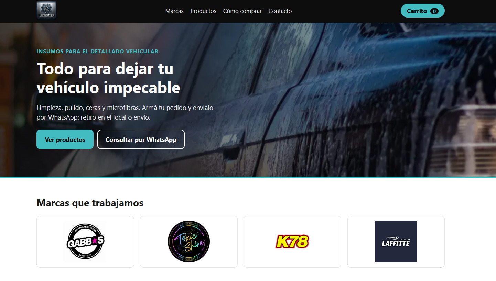

# Kerberos Estética Vehicular — sitio de demostración

Sitio estático (HTML, CSS y JavaScript sin dependencias) para un local de insumos para el detallado vehicular.

**Aclaración:** es un proyecto de demostración. Fue desarrollado como propuesta y el cliente no llegó a concretar el trabajo. Los datos de contacto, productos y precios son de ejemplo.

## Funcionalidades
- Catálogo con filtros por categoría y marca.
- Carrito guardado en `localStorage`.
- Envío del pedido por WhatsApp con el detalle de productos y tipo de entrega.

## Estructura
- `index.html`: estructura y textos.
- `styles.css`: diseño (variables de color en `:root`).
- `app.js`: filtros, carrito y envío por WhatsApp.
- `productos.js`: catálogo de ejemplo.
- `assets/`: logos e imágenes.

## Uso
Abrí `index.html` en el navegador. No requiere instalación.
